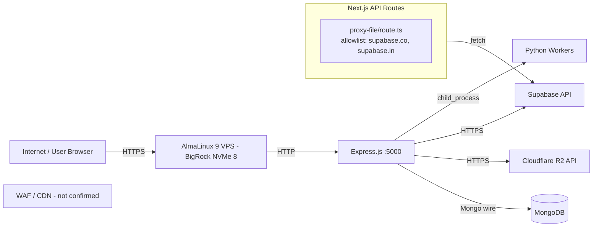

# ZipDrop System Architecture

**Project:** ZipDrop  
**Generated:** 2026-11-25  
**Source:** Repository inspection of `D:\Projects\ZipDrop`  
**Status:** Evidence-backed unless marked estimate/unverified

---

## 1. High-Level Overview

ZipDrop is a full-stack web application providing file sharing, conversion, compression, PDF manipulation, image background removal, and document editing. The architecture is a **colocated monolith**: a Node.js/Express backend and Next.js 14 frontend share a single VPS (AlmaLinux 9), with Python workers for CPU-intensive processing and dual cloud storage (Supabase primary, Cloudflare R2 secondary).

```mermaid
flowchart TD
    User[User Browser] -->|HTTPS| Frontend[Next.js 14 Frontend<br/>App Router]
    Frontend -->|API fetch| Backend[Express.js Backend<br/>server.js monolith]
    
    subgraph Frontend_Zone [Frontend Zone - Same VPS]
        direction TB
        Pages[Pages & Components<br/>app/ + components/]
        APIRoutes[Next.js API Routes<br/>app/api/* - proxy/edge logic]
        ClientLib[API Client<br/>utils/api.ts]
        Pages --> APIRoutes
        Pages --> ClientLib
        ClientLib --> Backend
    end

    subgraph Backend_Zone [Backend Zone - Same VPS]
        direction TB
        Express[Express App<br/>server.js - 2080 lines]
        Multer[multer.memoryStorage()<br/>in-memory file upload]
        ConvRouter[Conversion Router<br/>converters/index.js]
        CompRouter[Compression Router<br/>compression/index.js]
        ChildProc[child_process<br/>Python workers]
        Express --> Multer
        Express --> ConvRouter
        Express --> CompRouter
        Express --> ChildProc
    end

    subgraph Storage_Zone [External Storage]
        Supabase[Supabase Storage<br/>Primary file URLs]
        R2[Cloudflare R2<br/>S3-compatible secondary]
        Mongo[(MongoDB<br/>File metadata via Mongoose)]
    end

    subgraph Python_Workers [Python Workers - Same VPS]
        direction LR
        PyConv[pdf_converter.py<br/>pdf_merger.py<br/>pdf_splitter.py<br/>pdf_organizer.py]
        PyComp[compression/pdf_compressor.py<br/>compression/image_compressor.py]
        PyBG[background_remover.py<br/>background_remover_worker.py<br/>rembg + onnxruntime]
        PyLO[libreoffice_worker.py<br/>office↔PDF]
    end

    ChildProc --> PyConv
    ChildProc --> PyComp
    ChildProc --> PyBG
    ChildProc --> PyLO

    Express -->|upload file URL| Supabase
    Express -->|upload file URL| R2
    Express -->|metadata| Mongo

    Backend -->|HTML/JSON/Blob| User
```

### Deployment Target (Owner-Provided, Unverified)

| Field | Value | Source |
|-------|-------|--------|
| Provider | BigRock | owner-provided |
| Plan | NVMe 8 VPS | owner-provided |
| vCPU | 4 | owner-provided |
| RAM | 8 GB | owner-provided |
| Storage | 200 GB NVMe SSD | owner-provided |
| OS | AlmaLinux 9 | owner-provided |
| Model | Frontend + backend on same VPS | owner-provided |

---

## 2. Backend Architecture (Express Monolith)

`backend/server.js` is a single 2080-line Express application. All route handlers are defined inline. Key structural layers:

### Layer 1 — App Setup & Middleware
- Express v5 application instance
- CORS with origin allowlist (`allowedOriginSet`, `normalizeOrigin`)
- Credentials enabled; exposed headers for compression stats
- Body parsing and `multer.memoryStorage()` for file uploads

### Layer 2 — File Upload (Memory)
- `multer.memoryStorage()` — entire file buffered in RAM
- Single-file routes: `upload.single("file")`
- Multi-file routes: `upload.array("files", N)` (20 for images-to-PDF, 50 for bulk compress)

### Layer 3 — Routing by Domain

| Domain | Routes | Delegation Target |
|--------|--------|-------------------|
| File sharing | `/upload`, `/share-text`, `/resend`, `/receive/:code` | Inline handlers + `FileModel` (Mongoose) |
| Conversion | 27 × `/convert/*` + `/convert/images-to-pdf` | `converters/index.js` router `.convert()` / `.convertMultiple()` |
| Compression | `/compress/*`, `/compress/images/bulk`, `/health/compression` | `compression/index.js` `getCompressionRouter()` |
| PDF tools | `/pdf/merge`, `/pdf/split`, `/pdf/organize` | `pdf-merger.js`, `pdf-splitter.js`, `pdf-organizer.js` |
| Image tools | `/image-tools/remove-background` | Python `background_remover.py` |
| Stats | `/stats` | Inline handler |

### Layer 4 — Conversion Router
`backend/converters/index.js` exports a `router` object:
- `.convert({ inputBuffer, inputFormat, outputFormat, options })` — single file
- `.convertMultiple({ inputBuffers, inputFormats, outputFormat, options })` — multi-file (images-to-PDF)
- Delegates to format-specific modules in `converters/` (e.g. `pdf-to-word.js`, `image-to-image.js`)

### Layer 5 — Compression Router
`backend/compression/index.js` exports `getCompressionRouter()` returning:
- `.compress({ inputBuffer, inputFormat, options })` — single file
- `.compressBulk({ files, options })` — ZIP archive output
- `.getCompressor(format)` — compressor instance
- `.getBulkSupportedFormats()` — supported bulk formats
- Compressor classes: `PDFCompressor`, `JPGCompressor`, `PNGCompressor`, `WEBPCompressor`, `BulkImageCompressor`, all extending `BaseCompressor`

### Layer 6 — Python Workers (child_process)
Spawned by Express for CPU-bound work:
- PDF conversion/merge/split/organize (`pypdf`, `pdf2docx`, `pikepdf`, `PyMuPDF`)
- Image/PDF compression (`pillow`, `pikepdf`)
- Background removal (`rembg`, `onnxruntime`)
- Office↔PDF (`libreoffice_worker.py` → LibreOffice subprocess)

### Layer 7 — Storage
- **Supabase** (primary): file storage, signed/public URLs
- **Cloudflare R2** (secondary): S3-compatible object storage
- **MongoDB** (Mongoose): `FileModel` metadata records (`file_id`, `file_name`, `file_url`, `files`, `download_count`)

### Layer 8 — Error Handling
- Global error handler (after all routes): CORS headers + `{ error, code }` JSON
- 404 handler: CORS headers + `{ error: "Not found", code: "NOT_FOUND" }`
- Status mapping: 400 (input/unsupported/password/corrupted), 413 (too large), 503 (missing dependency), 500 (generic)

---

## 3. Frontend Architecture (Next.js 14 App Router)

```
frontend/app/
├── layout.tsx          Root layout
├── page.tsx            Landing page
├── sitemap.ts          Dynamic sitemap
├── about/, contact/, privacy/, terms/  Static pages
├── blog/[slug]/        38 blog posts
├── pdf/merge/, organize/, split/       PDF tools
├── compression/{jpg,pdf,png,webp}/     Compression tools
├── image-tools/background-remover/     AI background removal
├── conversion/<~28 tools>/             File conversion tools
├── editor/             Document editor (Tiptap)
└── api/                Next.js API routes (proxy/edge logic)
```

### Data Flow — File Share (Upload → Receive)

```
Client (UploadCard/FileUpload)
  │  FormData + file
  ▼
POST /api/send (Next.js route)  ──┐
  │                               │
  │  FormData → BACKEND/resend    │
  ▼                               │
POST /resend (Express)            │
  │  multer → RAM buffer          │
  ▼                               │
Supabase/R2 upload                │
  │  file URL                     │
  ▼                               │
MongoDB FileModel insert          │
  │  share code                   │
  ◀───────────────────────────────┘
  JSON { code, file_url } → Client
```

### Data Flow — File Receive

```
Client enters share code
  │
  ▼
GET /receive/:code (Express)
  │
  ▼
MongoDB findOne { file_id: code }
  │  increment download_count
  ▼
Return { type: "files"|"text", files|text }
```

### Data Flow — Conversion

```
Client uploads file to frontend API route
  │  (e.g. /api/convert-pdf-to-docx)
  ▼
Frontend validates (PDF signature, size ≤ 50 MB)
  │
  ▼
Backend /convert/pdf-to-word (Express)
  │  multer → RAM
  ▼
Python pdf_converter.py (child_process)
  │  output buffer
  ▼
Stream buffer back to client
  │  Content-Type: application/vnd...
  ▼
Browser download
```

### Frontend API Client (`frontend/utils/api.ts`)
All functions use `fetch()` to `API_BASE + endpoint`, return `Blob` + parsed stats from response headers (`X-Original-Size`, etc.).

---

## 4. Storage Architecture

```
┌─────────────────────────────────────────────────────────────┐
│                      Application Layer                      │
│  Express (file upload) ←→ multer.memoryStorage() ←→ RAM    │
└─────────────────────────────────────────────────────────────┘
                              │
          ┌───────────────────┼───────────────────┐
          ▼                   ▼                   ▼
    ┌─────────┐         ┌─────────┐         ┌─────────┐
    │ Supabase│         │ Cloudflare│         │  MongoDB│
    │ Storage │         │    R2   │         │ (Mongoose)│
    │  URL    │         │  URL    │         │ metadata │
    └────┬────┘         └────┬────┘         └────┬────┘
         │                   │                   │
         └───────────────────┴───────────────────┘
                             │
                    Returned to client as download URL
```

- **Supabase:** Primary storage; configured in `backend/config/supabase.js`
- **Cloudflare R2:** S3-compatible secondary; configured in `backend/config/r2.js`
- **MongoDB:** File share metadata via Mongoose `FileModel` (`backend/models/FileModel.js`)
- **In-memory:** `multer.memoryStorage()` buffers uploads before persisting to object storage

---

## 5. Concurrency & Resource Model

- **`backend/utils/concurrencyLimiter.js`**: limits concurrent Python worker processes to prevent oversubscription on the 4 vCPU / 8 GB VPS (estimate — contents partially read)
- **Python workers:** spawned via `child_process`; each conversion/compression/background-removal job is a separate process
- **Memory risk:** `multer.memoryStorage()` holds full file payloads in RAM; bulk uploads (50 images, 20 images-to-PDF) compound this
- **Cold start:** `rembg` downloads ONNX model on first run; LibreOffice spawn is heavy

---

## 6. Network & Security Boundaries



### Security Controls Observed
- **CORS origin allowlist** with credentials and exposed headers
- **PDF signature validation** (`%PDF-`) in `convert-pdf-to-docx/route.ts`
- **DOCX magic-byte check** (`PK` = 0x50 0x4B) in `convert-to-html/route.ts`
- **Supabase URL proxy allowlist** (`supabase.co`, `supabase.in`) in `proxy-file/route.ts`
- **robots.txt** disallows `/api/`, `/_next/`, `/_vercel/`

### Security Gaps (Not Confirmed Present)
- Rate limiting (express-rate-limit)
- Authentication/authorization layer (code-based sharing only, public-by-code)
- Helmet/security headers
- CSRF protection
- Disk-based or streamed file upload (currently memory-only)
- Secret management (`.env` contains real values; no `.env.example`)

---

## 7. Deployment Architecture (Planned — Owner-Provided)

```
┌──────────────────────────────────────────────────────────────┐
│                    BigRock NVMe 8 VPS                        │
│  AlmaLinux 9  |  4 vCPU  |  8 GB RAM  |  200 GB NVMe SSD   │
├──────────────────────────────────────────────────────────────┤
│                                                              │
│  ┌──────────────┐    ┌──────────────┐                        │
│  │  Next.js     │    │  Express.js  │                        │
│  │  (port 3000) │    │  (port 5000) │                        │
│  │  Frontend    │    │  Backend API │                        │
│  └──────┬───────┘    └──────┬───────┘                        │
│         │                   │                                 │
│         └───────────────────┴────────────────────────────────┘
│                              │                                 │
│                    ┌─────────▼─────────┐                      │
│                    │  Python Workers   │                      │
│                    │  (child_process)  │                      │
│                    └─────────┬─────────┘                      │
│                              │                                 │
│              ┌───────────────┼───────────────┐                │
│              ▼               ▼               ▼                │
│         ┌─────────┐    ┌─────────┐    ┌──────────┐          │
│         │Supabase │    │ Cloudflare│    │  MongoDB │          │
│         │ Storage │    │    R2   │    │ (Mongoose)│          │
│         └─────────┘    └─────────┘    └──────────┘          │
│                                                              │
│  Domain: getzipdrop.com  (DNS → Spaceship registrar)         │
│  AdSense tags on frontend pages                              │
└──────────────────────────────────────────────────────────────┘
```

### Prior Deployment Attempts (Historical)
- `nixpacks.toml` — Nixpacks build targeting `node backend/server.js` (Render)
- `railway.json` — Nixpacks builder (Railway)
- Neither Dockerfile nor docker-compose.yml present in repo

---

## 8. Directory-to-Runtime Mapping

| Logical Component | Physical Path | Runtime |
|-------------------|---------------|---------|
| Express app | `backend/server.js` | Node.js |
| Conversion logic | `backend/converters/*.js` | Node.js |
| Compression logic | `backend/compression/*.js` | Node.js |
| Python workers | `backend/*.py`, `backend/compression/*.py` | Python 3 |
| File metadata model | `backend/models/FileModel.js` | Node.js (Mongoose) |
| Supabase client | `backend/config/supabase.js` | Node.js |
| R2 client | `backend/config/r2.js` | Node.js |
| Concurrency limiter | `backend/utils/concurrencyLimiter.js` | Node.js |
| Setup scripts | `backend/scripts/*.mjs` | Node.js |
| Next.js frontend | `frontend/app/`, `frontend/components/`, `frontend/lib/`, `frontend/utils/` | Node.js (Next.js) |
| Frontend API routes | `frontend/app/api/*/route.ts` | Node.js (Next.js serverless) |

---

## 9. Known Gaps in Architecture

1. No reverse proxy (nginx/Apache) config confirmed — VPS would need one for TLS termination and port mapping (3000/5000 → 80/443)
2. No process manager (PM2/systemd) config confirmed
3. No Docker containerization
4. No CI/CD pipeline
5. No async job queue — conversions run inline in request cycle (may block for large files)
6. No object lifecycle/expiration policy for shared files
7. No CDN for static assets

---

*End of system architecture document.*
